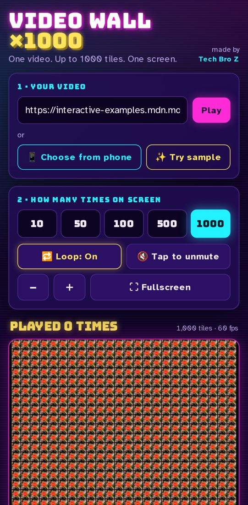

# 🎬 Video Wall ×1000 — ek video, 1000 baar, ek hi screen pe

**Live app:** https://video-wall-1000.sites.tab.bot/

Video ka direct link daalo (ya phone se video choose karo), count chuno — **10 / 50 / 100 / 500 / 1000** — aur wahi video ek hi screen pe grid (video wall) mein utni baar ek saath chalegi. Loop on/off, "played 37 times" counter, fullscreen, zoom — sab hai.



## ⬇️ Download (v1.0)
- Zip: [video-wall-1000-techbroz-v1.0.zip](https://github.com/nm621532-byte/video-wall-1000-techbroz/raw/main/release/video-wall-1000-techbroz-v1.0.zip)
- Release page: https://github.com/nm621532-byte/video-wall-1000-techbroz/releases/tag/v1.0

Zip kholo, `index.html` browser mein kholo — bas. (Sample button ke liye internet chahiye, ya zip ka `sample.mp4` kaam karega jab site kisi server se chale: `python3 -m http.server`.)

## ✨ Features
- 🔗 Direct video link (.mp4 / .webm) ya 📱 phone se video choose karo (video phone se bahar nahi jaati)
- 🔢 10, 50, 100, 500, 1000 tiles ek saath
- 🔁 Loop toggle + **"played N times"** counter (aur kitne "tile plays" hue)
- 🔇 Muted autoplay, ek tap mein unmute
- ⛶ Fullscreen, ＋/− zoom, pinch / scroll
- ✨ "Try sample" button — CC0 "flower" clip turant demo ke liye

## 🧠 Trick: phone crash kyun nahi hota?
1000 `<video>` tags = phone hang. Isliye:
1. **Sirf EK hidden `<video>`** chalta hai.
2. Ek `<canvas>` pe har frame mein video sirf **ek baar** tile #1 mein draw hota hai.
3. Phir canvas khud ko copy karta hai — 1 → 2 → 4 → 8 … (doubling). 1000 tiles ke liye ~20 `drawImage` calls, 1000 nahi!
4. `requestAnimationFrame` loop, devicePixelRatio max 2, canvas size cap — phone pe bhi ~60 fps.

Agar link CORS allow nahi karta, tab bhi canvas pe chalta hai; tiles kaali dikhen to **Simple mode** (max 50 `<video>` tiles) ka button hai.

## 🚫 Kya NAHI karta
Ye ek **local video wall** hai — video sirf aapki screen pe chalti hai. **YouTube / Instagram / TikTok pe koi view nahi banta**, aur un sites ke page links support nahi hain (app bolega: *"Direct video link ya phone se video choose karo"*). Koi YouTube iframe embed nahi hai.

## 🛠️ Khud chalao
```bash
git clone https://github.com/nm621532-byte/video-wall-1000-techbroz.git
cd video-wall-1000-techbroz
python3 -m http.server 8000
# browser: http://localhost:8000
```
Sirf ek file hai: `index.html` (HTML + CSS + JS, koi framework nahi).

## ✅ Testing
`test/test_wall.py` (Playwright, Pixel 7 mobile view): sample load → 1000 select → canvas pe 1000 tiles ke pixels check → fps → loop counter → YouTube/Instagram link ka message → koi iframe nahi.
```bash
pip install playwright && playwright install chromium
python3 test/test_wall.py http://localhost:8000/ shot.png
```

## Credits
Made by **Tech Bro Z** — YouTube [@techbrozdeveloper](https://www.youtube.com/@techbrozdeveloper), Instagram [@tech_bro_z_1](https://www.instagram.com/tech_bro_z_1/)
Sample video: "flower" (CC0) from MDN interactive examples. License: MIT.
